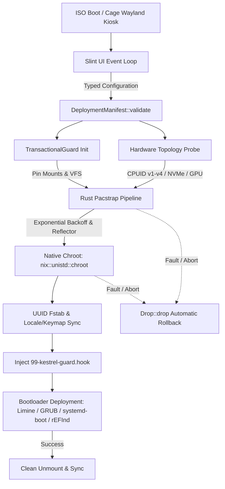

<div align="center">

# 🦅 KESTREL ARCH
### Automated, Hardware-Aware Arch Linux Provisioning & Self-Healing Rescue Engine

[](https://github.com/Kestrel-Arch/Kestrel-Installer/actions)
[](https://www.rust-lang.org/)
[](https://slint.dev/)
[](https://archlinux.org/)
[](https://huggingface.co/datasets/eadxm)
[](https://www.gnu.org/licenses/agpl-3.0)

<p align="center">
  <a href="#-quick-start--deployment"><b>Quick Start</b></a> •
  <a href="#-why-kestrel-arch"><b>Why Kestrel?</b></a> •
  <a href="#-core-engineering"><b>Architecture</b></a> •
  <a href="#-the-workspace--software-matrix"><b>17+ Workspaces</b></a> •
  <a href="#-in-place-recovery--self-healing-guard"><b>Self-Healing</b></a> •
  <a href="#️-local-development"><b>Build from Source</b></a>
</p>

---

**Replacing brittle shell scripts and heavy Python frameworks with a deterministic, memory-safe Rust execution engine (`engine.rs`) and a hardware-accelerated Slint Wayland GUI.**  
*Deploy a tuned Arch Linux workstation in under 3 minutes—with RAII transactional rollbacks and automated kernel recovery.*


</div>

---

## ⚡ Quick Start & Deployment

> [!TIP]
> **Already booted into a vanilla Arch Linux Live USB?**  
> Launch the Kestrel graphical provisioning engine directly from memory with a single command:
> ```bash
> bash <(curl -sL [https://kestrel.s.gy/eadxm](https://kestrel.s.gy/eadxm))
> ```

### Pre-Built Live ISOs (Hugging Face Global CDN)
Kestrel distributes two dedicated ISO profiles via **[GitHub Releases](https://github.com/Kestrel-Arch/Kestrel-Installer/releases)**:

| Edition | Size | Best For | Architecture & Payload |
| :--- | :--- | :--- | :--- |
| **Offline ISO** | `~4.3 GB` | Air-gapped installs, unstable Wi-Fi, rapid rescue | Bundled local repo (`kestrel-offline.db.tar.gz`). Deploys **Hyprland**, **KDE Plasma 6**, or **XFCE** with zero internet connectivity. |
| **Online ISO** | `~1.7 GB` | Bleeding-edge packages & all 17 workspaces | Lightweight live kiosk that streams fresh packages directly from Arch & Chaotic-AUR mirrors with automatic failover. |

```bash
# Write to USB drive (replace /dev/sdX with your target block device)
sudo dd if=Kestrel-Arch-offline.iso of=/dev/sdX bs=4M status=progress oflag=sync
```

---

## 🔥 Why Kestrel Arch?

Most Linux installers are either fragile linear bash scripts that leave your disks half-mounted on network failure, or bloated Python/Qt frameworks that consume gigabytes of RAM in the live environment. Kestrel treats OS provisioning as a **systems programming problem**.

| Capability | **Kestrel Arch (`engine.rs`)** | `archinstall` (Official) | Calamares |
| :--- | :--- | :--- | :--- |
| **Core Runtime** | **Native Rust** (`nix`, `sysinfo`, `serde`) | Python | C++ / Python |
| **UI Stack** | **Slint (Wayland Kiosk via Cage)** | Terminal TUI | Qt5 / Qt6 (X11/Wayland) |
| **Fault Recovery** | **RAII `TransactionalGuard` (`Drop` unwind)** | Manual cleanup required | Partial |
| **Microarch Optimization** | **Native CPUID (`x86-64-v3`/`v4` CachyOS BORE)** | Generic `x86_64` | Distro-dependent |
| **Manual Partition Safety** | **Superblock probing (preserves user formats)** | Prone to re-format overrides | Standard |
| **Post-Install Protection** | **Automated ALPM Kernel Doctor Hook** | None | None |
| **Offline Full-Desktop Install**| **Yes (Hyprland / Plasma 6 / XFCE)** | No (Requires network) | Distro-dependent |

---

## 🧠 Core Engineering

### 1. RAII Transactional Rollback (`TransactionalGuard`)
Kestrel implements Rust's `Drop` trait across all block and virtual filesystem operations. If a deployment faults at any stage—whether from a mirror timeout, corrupted package signature, or user cancellation—`TransactionalGuard` automatically unwinds the state machine:
- Detaches virtual filesystems (`/proc`, `/sys`, `/dev`, `/run`) in strict reverse topological order (`MNT_DETACH`).
- Deactivates swap partitions and closes active block handles.
- Leaves the target storage cleanly unmounted and ready for immediate retry without rebooting the live ISO.

### 2. Superblock-Preserving Partition Probing
Traditional GUI installers frequently clobber pre-formatted partitions during custom partitioning workflows. When you partition via **GParted** or manual layout assignment, Kestrel inspects raw partition superblocks (`btrfs`, `ext4`, `xfs`, `f2fs`) natively. Existing user-formatted filesystems are preserved and mounted with hardware-tuned flags (e.g., `compress=zstd:3,noatime` for Btrfs) rather than blindly overwritten with default `ext4` mkfs calls.

### 3. Native CPUID & Hardware Topology Profiling
Without spawning external shell utilities, Kestrel queries CPU instruction set extensions via `std::arch::is_x86_feature_detected!` (`x86-64-v4`, `v3`, `v2`, `v1`) alongside kernel block parameters:
- **Microarchitecture:** Automatically provisions optimized kernel trees (including **CachyOS BORE**) matched to your silicon.
- **Storage I/O Schedulers:** Inspects `/sys/block/*/queue/rotational` to write persistent udev rules (`/etc/udev/rules.d/60-kestrel-iosched.rules`)—assigning `none` for NVMe, `mq-deadline` for SATA SSDs, and `bfq` for mechanical HDDs.
- **PCIe GPU Provisioning:** Identifies NVIDIA, AMD, and Intel vendor IDs to configure drivers, PRIME render offload, and D3cold idle sleep power rules.
- **Mobile Power Rails:** Detects `/sys/class/power_supply/BAT*` to automatically deploy `power-profiles-daemon`, `sof-firmware`, and `alsa-ucm-conf`.

### 4. Asynchronous IPC & Mirror Failover
- **Lock-Free UI Telemetry:** The Slint frontend communicates with worker threads over typed `std::sync::mpsc` channels, streaming real-time stdout/stderr logs and granular progress percentages at 60 FPS.
- **Exponential-Backoff Pacstrap:** Survives flaky Wi-Fi and dead mirrors by dynamically re-ranking mirrors via `reflector` and retrying failed transactions automatically.

---

## 🏗️ System Architecture & State Machine



<details>
<summary><b>📂 View Repository Directory Structure</b></summary>

```text
Kestrel-Installer/
├── .github/workflows/          # CI/CD pipelines (Offline/Online ISOs, GUI Releases, Pages)
├── airootfs/
│   └── gui-src/                # Rust & Slint native source code
│       ├── Cargo.toml          # Rust dependencies & release optimization profiles
│       ├── build.rs            # Slint UI compiler build script
│       ├── src/
│       │   ├── main.rs         # Slint UI controller & mpsc telemetry channels
│       │   └── engine.rs       # Native Rust provisioning & recovery backend
│       └── ui/
│           ├── installer.slint # Declarative Slint interface & styling
│           ├── fonts/          # Embedded typography (Geomini, Cascadia Code)
│           └── logo.svg        # Vector brand assets
├── web/                        # Dioxus / WebAssembly landing page source
├── bootstrap.sh                # Universal Live ISO bootstrapper
├── packages.x86_64             # Base live-environment package manifest
└── README.md
```
</details>

---

## 📦 The Workspace & Software Matrix

Kestrel deploys **17 pre-configured desktop environments and window managers** with isolated `xdg-desktop-portal` backends, paired with your choice of bootloader and privacy-tuned browser.

### 🖥️ Supported Workspaces (17 Environments)

| Category | Environment | Stack & Configuration Highlights |
| :--- | :--- | :--- |
| **Wayland Compositors** | **Hyprland** *(Default)* | Dynamic tiling Wayland compositor pre-wired with `xdg-desktop-portal-hyprland`. |
| | **Niri** | Scrollable-tiling Wayland compositor engineered in Rust on Smithay. |
| | **COSMIC** | System76's next-gen modular Rust desktop built on Iced and Smithay. |
| | **Sway** | Drop-in i3-compatible Wayland compositor with `xdg-desktop-portal-wlr`. |
| | **Wayfire** | 3D-accelerated wlroots Wayland compositor with smooth visual effects. |
| **Full Desktops** | **KDE Plasma 6** | Flagship Wayland desktop with full systemd integration and power management. |
| | **GNOME 46+** | Modern workstation desktop with isolated Wayland services and GDM. |
| | **Cinnamon / Budgie / MATE** | Traditional, ergonomic GTK desktop paradigms tuned for responsiveness. |
| **X11 / Hybrid Tiling & Light** | **XFCE 4.18+** | Ultra-stable, low-overhead desktop environment (Included on Offline ISO). |
| | **i3-wm / bspwm / Qtile** | Minimalist manual and binary-space tiling window managers for keyboard purists. |
| | **LXQt / LXDE / Openbox** | Featherweight Qt6 and X11 stacking environments for legacy or low-RAM hardware. |

### 🚀 Boot Managers & Web Browsers

| Component | Options Available | Highlights |
| :--- | :--- | :--- |
| **Bootloaders** | **Limine** · **GRUB** · **systemd-boot** · **rEFInd** | Full support for Legacy BIOS & UEFI (GPT), `os-prober` multi-booting, and Btrfs snapshots. |
| **Web Browsers** | **Zen Browser** *(Rec)* · **LibreWolf** · **Brave** · **Firefox** · **Falkon** | Pre-cached **Falkon** on Offline media; hardened privacy & vertical-tab workflows online. |

---

## 🚑 In-Place Recovery & Self-Healing Guard

Kestrel doesn't disappear after first boot—it actively protects your rolling-release installation against interrupted updates.

> [!IMPORTANT]
> **Automated ALPM Kernel Guard (`99-kestrel-guard.hook`)**  
> Every Kestrel deployment installs a native Pacman post-transaction hook linked to `/usr/local/bin/kestrel-doctor`. If a kernel upgrade is interrupted or power drops mid-update:
> 1. Stale `/var/lib/pacman/db.lck` locks are safely cleared.
> 2. `/boot/vmlinuz-*` and `/boot/initramfs-*.img` integrity and byte-sizes are verified.
> 3. Kernel modules are synchronized and `mkinitcpio -P` is automatically re-invoked before reboot—eliminating unbootable initramfs panics.

### Live USB One-Click System Repair
If an external factor breaks your bootloader or kernel:
1. Boot the Kestrel USB and click **Repair System** (or launch `kestrel-gui --repair`).
2. Kestrel scans all block devices for existing **Arch Linux**, **CachyOS**, or **Kestrel** installations (including nested Btrfs subvolumes).
3. Select your kernel (`linux` or `linux-cachyos`) and bootloader. Kestrel mounts the system inside a managed chroot jail, rebuilds initramfs images, and restores bootloader entries **without touching `/home`**.

---

## 🖥️ System Requirements

| Specification | Minimum | Recommended |
| :--- | :--- | :--- |
| **CPU Architecture** | `x86_64` (`v1` baseline) | `x86_64-v3` / `x86_64-v4` (AVX2 / AVX-512) |
| **Firmware** | Legacy BIOS (MBR/GPT) | UEFI (GPT) |
| **Memory (RAM)** | 1.5 GB *(Auto-backed by ZRAM swap)* | 4 GB+ |
| **Storage** | 16 GB | 30 GB+ NVMe / SSD |
| **Graphics** | Framebuffer (`pixman` software fallback) | Wayland-capable GPU (Intel / AMD / NVIDIA) |

---

## 🛠️ Local Development

### Prerequisites
Ensure you have the stable Rust toolchain (`rustup default stable`) and required system libraries installed:
```bash
sudo pacman -S --needed base-devel cmake pkgconf fontconfig freetype2 libx11 libxkbcommon wayland
```

### Compiling & Running the Installer GUI
```bash
git clone [https://github.com/Kestrel-Arch/Kestrel-Installer.git](https://github.com/Kestrel-Arch/Kestrel-Installer.git)
cd Kestrel-Installer/airootfs/gui-src

# Compile with release optimizations
cargo build --release

# Launch UI locally (destructive disk operations are gated behind confirmation dialogs)
cargo run --release
```

---

## 📄 Licensing

Kestrel Arch is dual-licensed:

- **Open-Source / Non-Commercial ([AGPL v3](LICENSE)):** Free software licensed under the **GNU Affero General Public License v3**. You may run, study, modify, and redistribute this software under the terms of the AGPL, provided all derivative works remain open-source under the same license.
- **Commercial / Proprietary Licensing:** To integrate Kestrel Arch or its provisioning engine into commercial distributions, hardware appliances, or closed-source products, contact **[kestrel.arch.dev@gmail.com](mailto:kestrel.arch.dev@gmail.com)**.

<div align="center">
  <br>
  <b>Built with 🦀 Rust & Slint for the Arch Linux Community</b><br>
  <sub>If Kestrel saved you time or rescued your system, consider dropping a ⭐ on the repo!</sub>
</div>
